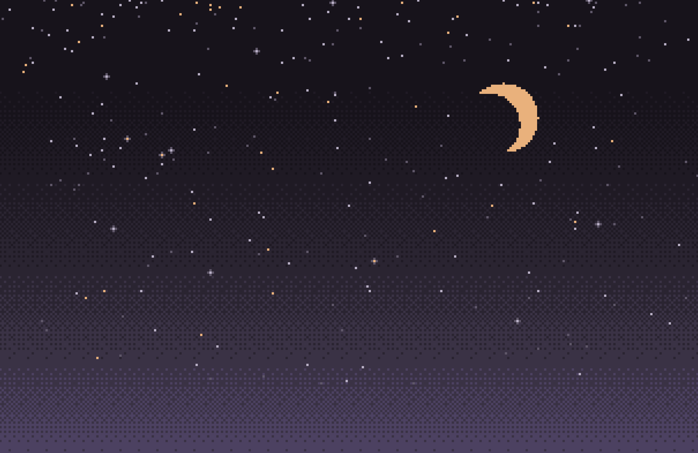
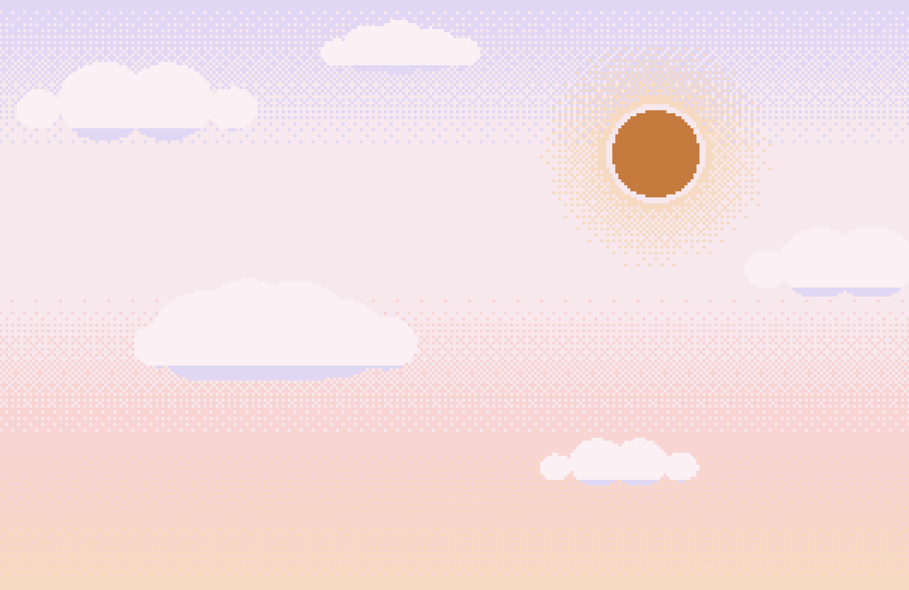
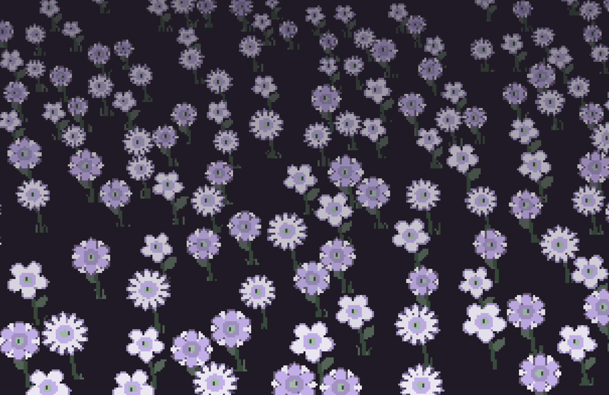
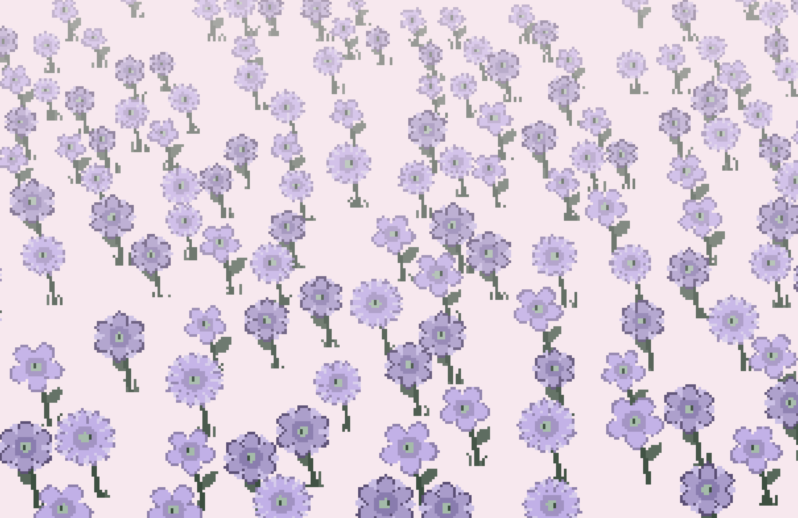
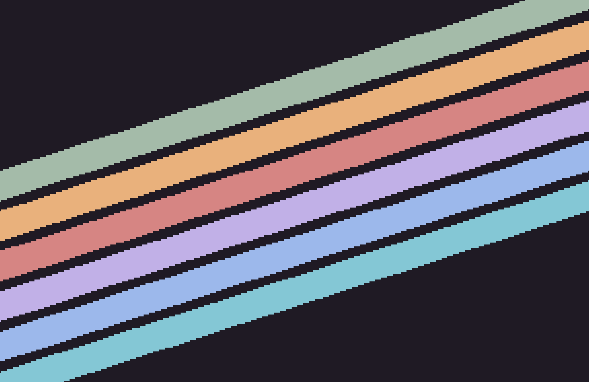
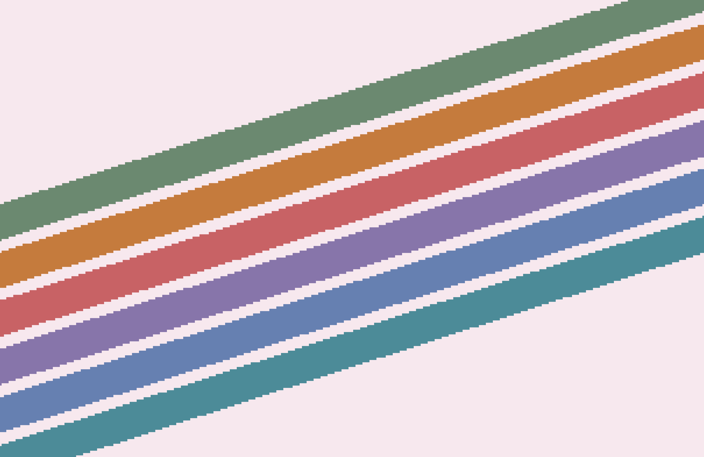
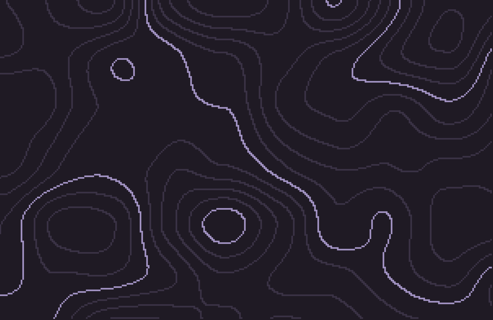
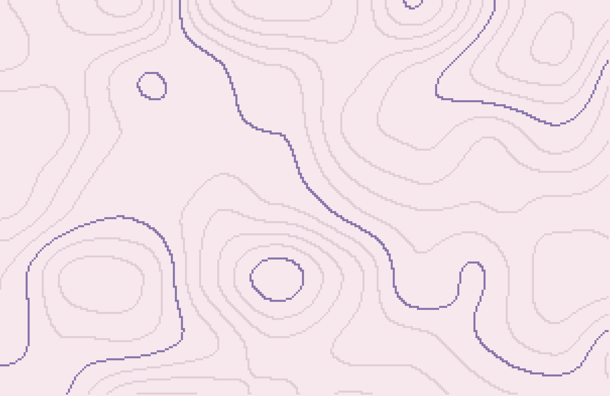
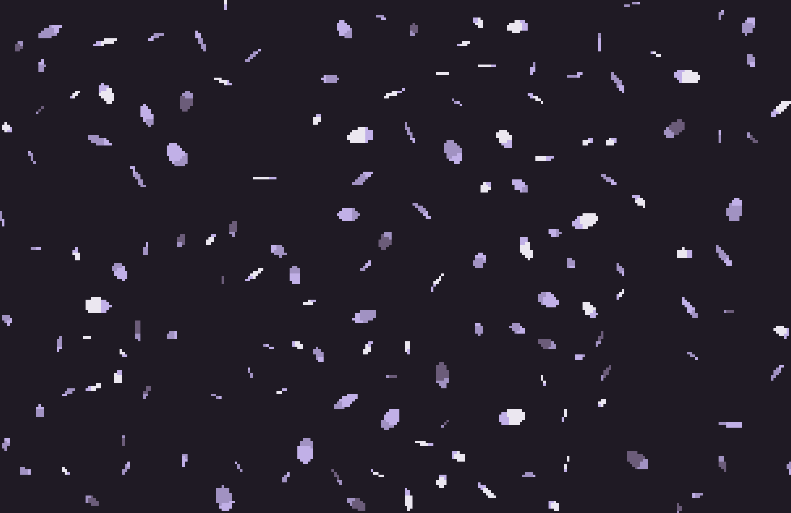
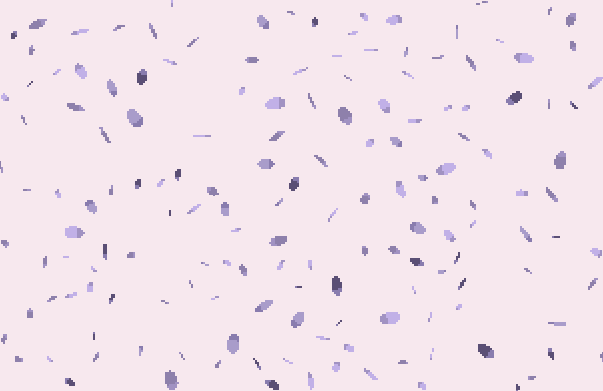

# Wallpapers

Each one comes in 3024x1964 and 3840x2160, with a `meadow-dynamic` HEIC that follows the macOS appearance.

## Sky

  
  

## Field

  
  

## Stripes

  
  

## Contours

  
  

## Petals

  
  

## Plain

  
  

